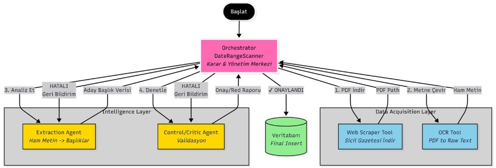
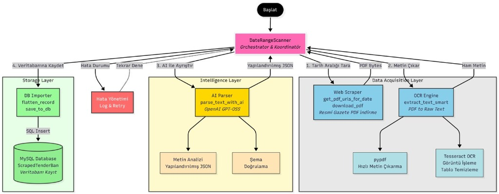
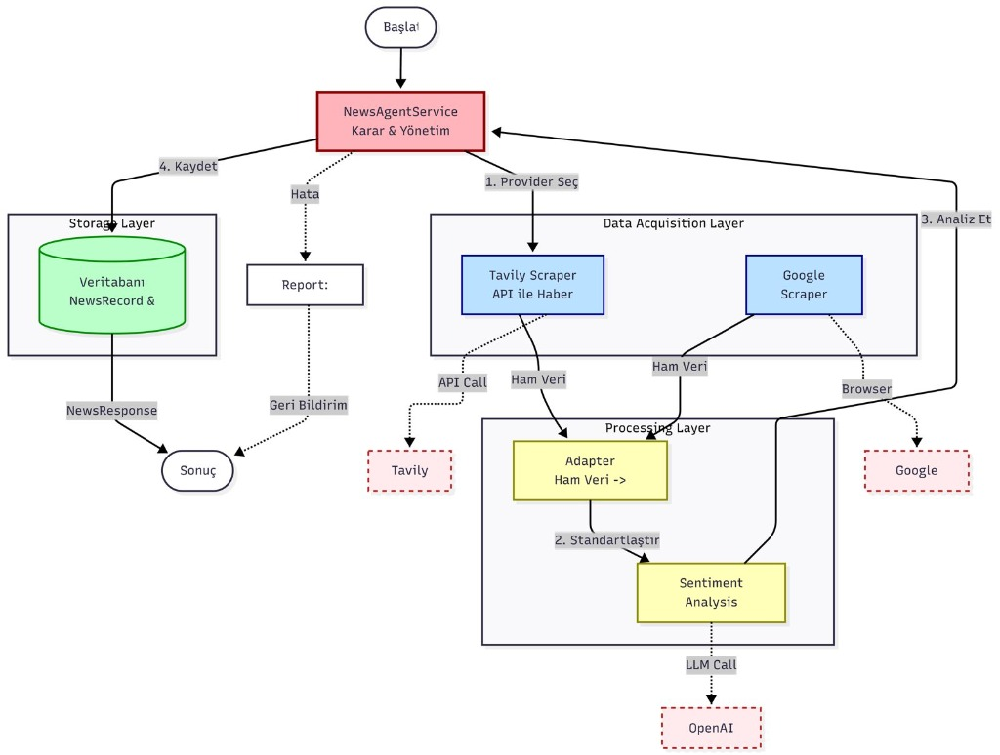
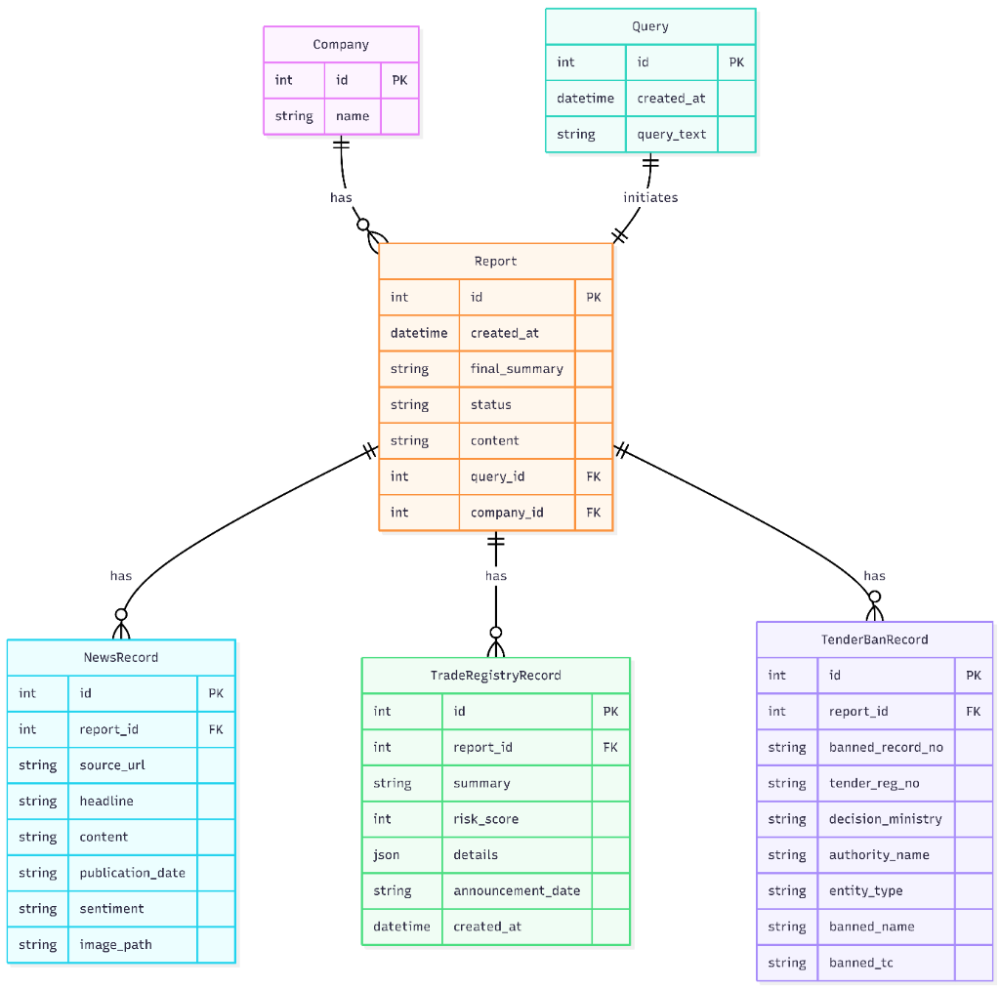

# Sigmoid AI Agent - Şirket İstihbarat ve Raporlama Platformu

Bu proje, yapay zeka ajanları kullanarak şirketler hakkında derinlemesine istihbarat toplayan, verileri analiz eden ve kapsamlı raporlar oluşturan modern bir web uygulamasıdır.

## 🎯 Proje Hakkında


Bu platform, şirketler hakkında çeşitli kaynaklardan (haber siteleri, Resmi Gazete, ihale yasakları vb.) veri toplayarak, bu verileri Büyük Dil Modelleri (LLM) ile işler. Amacı, finansal ve operasyonel riskleri değerlendirmek için kullanıcılara özetlenmiş, eyleme geçirilebilir içgörüler sunmaktır.

### Temel Özellikler
*   **Yapay Zeka Destekli Ajanlar**: LangGraph ve OpenAI kullanarak haber tarama, analiz ve raporlama süreçlerini otomatize eden akıllı ajanlar.
*   **Resmi Gazete ve İhale Yasakları Takibi**: İhale yasaklı şirketleri tespit etmek için OCR ve web kazıma (scraping) teknolojileri.
*   **Haber Analizi**: Şirketle ilgili güncel haberleri Google News ve diğer kaynaklardan toplayıp duygu analizi (sentiment analysis) yapma.
*   **Otomatik Rapor Üretimi**: Toplanan tüm verileri birleştirerek markdown formatında detaylı şirket raporları oluşturma.
*   **Modern Arayüz**: Next.js ve Tailwind CSS ile geliştirilmiş kullanıcı dostu dashboard.

---

## 🛠 Teknoloji Yığını (Tech Stack)

### Backend (Sunucu Tarafı)
*   **Framework**: FastAPI (Python)
*   **Veritabanı**: PostgreSQL
*   **AI & ML**: LangChain, LangGraph, OpenAI GPT (varsayılan: `gpt-6-luna`)
*   **Scraping & OCR**: Playwright, BeautifulSoup4, Tesseract OCR, PDF2Image
*   **Asenkron İşlemler**: AsyncIO

### Frontend (İstemci Tarafı)
*   **Framework**: Next.js 15+ (React)
*   **Stil**: Tailwind CSS, Radix UI
*   **Dil**: TypeScript
*   **Görselleştirme**: Lucide Icons

### Altyapı
*   **Containerization**: Docker & Docker Compose

## 📄 Doküman Okuma ve İşleme Yaklaşımı

Bu proje, özellikle Ticaret Sicil Gazetesi ve İhale Yasakları gibi kaynaklardan gelen **görsel ağırlıklı PDF dokümanlarını** işlemek için güçlü bir OCR (Optik Karakter Tanıma) hattı kullanır:

1.  **Format Dönüştürme**: İndirilen PDF dosyaları, `pdf2image` kütüphanesi kullanılarak yüksek çözünürlüklü görsellere dönüştürülür.
2.  **OCR İşlemi**: Görseller, **Tesseract OCR Engine** (`pytesseract`) kullanılarak metne çevrilir. Bu süreçte Türkçe dil desteği (`lang='tur'`) aktif edilerek karakter hataları minimize edilir.
3.  **Metin Temizleme ve Analiz**: Ham OCR çıktıları, gereksiz boşluk ve karakterlerden temizlendikten sonra analiz için LLM'e (Büyük Dil Modeli) beslenir.

<div align="center">
  
  <p><em>Şekil 1: Sicil Gazetesi Ajanı Akış Şeması</em></p>
</div>

<div align="center">
  
  <p><em>Şekil 2: Resmi Gazete (İhale Yasakları) Akış Şeması</em></p>
</div>

<div align="center">
  
  <p><em>Şekil 3: Haber Analiz Ajanı ve Süreci</em></p>
</div>

### 3. Sentez ve Raporlama
Tüm ajanlar işini bitirdiğinde, veriler **Reporter Node**'a iletilir. Burada OpenAI GPT tabanlı bir LLM, tüm parçalı bilgileri birleştirerek; "Genel Görünüm", "Riskler" ve "Sicil Hareketleri" başlıkları altında yönetici özeti oluşturur.

---

## 🗄️ Veritabanı Şeması

Projenin veritabanı yapısı, şirketler, sorgular, raporlar ve çeşitli veri kaynaklarından gelen kayıtlar arasındaki ilişkileri gösterir:



---

## 🚀 Kurulum ve Çalıştırma

Projeyi çalıştırmanın en kolay yolu **Docker** kullanmaktır.

### Ön Koşullar
*   [Docker Desktop](https://www.docker.com/products/docker-desktop/) (Windows/Mac/Linux için)
*   Git

### Adım 1: Projeyi Klonlayın
```bash
git clone <repository-url>
cd sigmoid-ai-agent-hackathon
```

### Adım 2: Çevresel Değişkenleri (Environment Variables) Ayarlayın

Kök dizindeki `.env.example` dosyasını kopyalayarak `.env` oluşturun:
```bash
cp .env.example .env
```
`.env` dosyasını açın ve gerekli API anahtarlarını (`OPENAI_API_KEY`, `TAVILY_API_KEY`) ekleyin. `.env` dosyası `.gitignore` içindedir, asla commit etmeyin.

Model ayarları da `.env` üzerinden yapılır:

| Değişken | Varsayılan | Açıklama |
|---|---|---|
| `OPENAI_MODEL_NAME` | `gpt-6-luna` | Kullanılacak OpenAI modeli |
| `OPENAI_BASE_URL` | `https://api.openai.com/v1` | OpenAI uyumlu API adresi |
| `OPENAI_REASONING_EFFORT` | `none` | `gpt-6-luna` için Chat Completions üzerinden tool calling `none` gerektirir. Desteklemeyen modellerde boş bırakın. |
| `OPENAI_SEND_TEMPERATURE` | `false` | Özel temperature değerini kabul eden modellerde `true` yapın. |

### Adım 3: Uygulamayı Başlatın (Docker ile)

Tüm sistemi (Veritabanı, Backend ve Frontend) tek komutla ayağa kaldırın:

```bash
docker compose up --build
```

Bu işlem ilk seferde imajların indirilmesi ve oluşturulması nedeniyle birkaç dakika sürebilir.

*   **Backend API**: `http://localhost:8000`
*   **API Dokümantasyonu (Swagger UI)**: `http://localhost:8000/docs`
*   **Frontend Arayüzü**: `http://localhost:3000`
*   **PostgreSQL**: `localhost:5435` (kullanıcı/şifre: `postgres`/`postgres`, veritabanı: `ai_agent_db`)

Durdurmak için `docker compose down`, veritabanını da silmek için `docker compose down -v`.

---

## 💻 Manuel Kurulum (Geliştirme İçin)

Docker kullanmadan, servisleri ayrı ayrı çalıştırmak isterseniz:

### Backend Kurulumu

1.  Python sanal ortamı oluşturun ve aktif edin:
    ```bash
    python -m venv venv
    # Windows:
    .\venv\Scripts\activate
    # Mac/Linux:
    source venv/bin/activate
    ```
2.  Bağımlılıkları yükleyin:
    ```bash
    pip install -r requirements.txt
    ```
    *(Not: OCR işlemleri için sisteminizde Tesseract kurulu olmalıdır)*

3.  Veritabanını başlatın (Docker ile sadece db çalıştırabilirsiniz):
    ```bash
    docker compose up -d postgres
    ```
4.  Uygulamayı çalıştırın:
    ```bash
    uvicorn app.main:app --reload
    ```

### Frontend Kurulumu

1.  Frontend klasörüne gidin:
    ```bash
    cd frontend
    ```
2.  Bağımlılıkları yükleyin:
    ```bash
    npm install
    ```
3.  Geliştirme sunucusunu başlatın:
    ```bash
    npm run dev
    ```
    Uygulama `http://localhost:3000` adresinde çalışacaktır.

---

## 📂 Proje Yapısı

```
sigmoid-ai-agent-hackathon/
├── app/                    # Backend kaynak kodları
│   ├── agents/             # AI ajanları (Orchestrator, News, Report vb.)
│   ├── api/                # API endpoint'leri ve router'lar
│   ├── core/               # Temel konfigürasyonlar
│   ├── db/                 # Veritabanı modelleri ve bağlantıları
│   ├── services/           # İş mantığı servisleri
│   └── main.py             # Uygulama giriş noktası
├── frontend/               # Frontend kaynak kodları (Next.js)
│   ├── app/                # Sayfalar ve layout
│   ├── components/         # React bileşenleri
│   ├── lib/                # Yardımcı fonksiyonlar
│   └── Dockerfile          # Frontend için Docker imaj tanımı
├── docker-compose.yml      # Docker servis tanımları
├── Dockerfile              # Backend için Docker imaj tanımı
└── requirements.txt        # Python bağımlılıkları
```

## 📝 Kullanım

1.  Arayüzü açın (`http://localhost:3000`).
2.  Bir şirket adı girin veya mevcut listelerden seçim yapın.
3.  Sistem arka planda haberleri tarayacak, resmi kayıtları kontrol edecek ve yapay zeka ile analiz yapacaktır.
4.  Sonuç olarak kapsamlı bir rapor ve risk analizi sunulacaktır.

---
**Geliştirici Notu**: Herhangi bir hata alırsanız, `app/logs` altındaki log dosyalarını kontrol edebilirsiniz.
